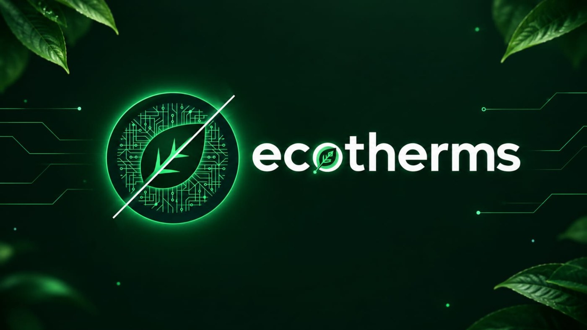
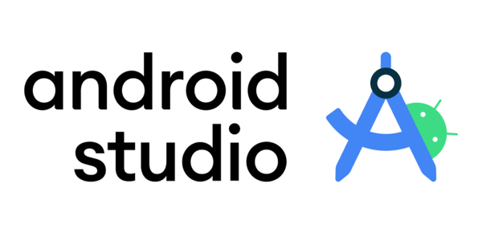
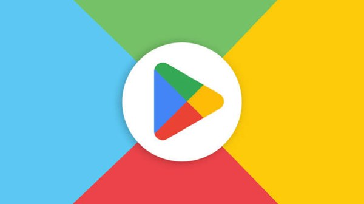

<p align="center"></p>

# 🌱 Ecotherms

Aplicativo Android para **monitoramento de estufas** (umidade e temperatura do solo, irrigação) e **identificação de plantas por foto**. Trabalho de Conclusão de Curso — Colégio Técnico "Antônio Teixeira Fernandes" / Univap.

<!-- Adicione prints em docs/screenshots e referencie aqui:
<p align="center">  </p>
-->

## Funcionalidades

- Login e cadastro por **e-mail/senha** e **Google Sign-In** (Firebase Auth)
- Painel em tempo real com os dados da estufa (Firebase Realtime Database) e alertas fora da faixa ideal
- **Gráficos** de histórico por métrica (MPAndroidChart)
- **Identificação de plantas** pela câmera via API Pl@ntNet, com histórico por usuário
- Perfil com foto (importada do Google ou da galeria, com recorte via uCrop), preferências e exclusão de conta

## Arquitetura

```
ESP32 (simulado) ──MQTT──▶ HiveMQ ──▶ Firebase Realtime Database ──▶ App Android (Kotlin)
                                                                   └─▶ Pl@ntNet API (identificação)
```

> Os sensores da estufa são **simulados** no protótipo; o pipeline de dados é real.

Estrutura: Activities em Kotlin com ViewBinding (organização inspirada em MVVM, sem ViewModel/LiveData), Retrofit/OkHttp para a Pl@ntNet, CameraX para captura.

Modelo de dados no Realtime Database:

```
estufas/estufa1: { temperatura, umidade, umidadeSolo, temperaturaSolo, irrigacao }
users/{uid}/profile
users/{uid}/history
```

## Stack

Kotlin · Android SDK 24–36 · Gradle (Kotlin DSL) · AGP 9.0 · Firebase Auth + Realtime Database · Google Sign-In · CameraX · Retrofit · MPAndroidChart · uCrop

---

## ▶️ Como executar no Android Studio

<p align="center"></p>

### Pré-requisitos
- Android Studio recente (compatível com AGP 9.0) — JDK 21 já vem embutido
- Uma conta Google (Firebase) e uma chave gratuita da [Pl@ntNet](https://my.plantnet.org/)

### 1. Clonar
```bash
git clone https://github.com/<USER>/Ecotherms.git
```
Abra a pasta no Android Studio (**File ▸ Open**) e aguarde o Gradle Sync.

### 2. Criar seu projeto Firebase
O repositório **não** inclui credenciais. Você precisa do seu próprio projeto:

1. Em [console.firebase.google.com](https://console.firebase.google.com), crie um projeto e **adicione um app Android** com o pacote `com.example.ecotherms`.
2. **Authentication ▸ Sign-in method**: ative **E-mail/senha** e **Google**.
3. **Realtime Database**: crie o banco e aplique as regras abaixo.
4. **Registre o SHA-1** do seu computador (necessário para o login Google):
   ```bash
   ./gradlew signingReport        # Windows: gradlew signingReport
   ```
   Copie o `SHA1` da variante `debug` em *Configurações do projeto ▸ Seus apps ▸ Impressões digitais*. Cada desenvolvedor registra o próprio; várias impressões coexistem.
5. Baixe o `google-services.json` (**depois** de ativar o Google e registrar o SHA-1) e salve em `app/google-services.json`.
   Ele deve conter um `oauth_client` com `client_type: 3`; se estiver vazio, o build falha com `Unresolved reference: default_web_client_id`.
   (`app/google-services.json.example` mostra o formato; o arquivo real está no `.gitignore`.)

Regras sugeridas para o Realtime Database:
```json
{
  "rules": {
    "estufas": { ".read": "auth != null", ".write": false },
    "users": { "$uid": { ".read": "auth.uid === $uid", ".write": "auth.uid === $uid" } }
  }
}
```
(`.write: false` em `estufas` bloqueia escrita pelo app; o publicador de dados — bridge MQTT→Firebase — deve usar credenciais de administrador. Ajuste se o seu fluxo for diferente.)

### 3. Chave da Pl@ntNet
No arquivo `local.properties` (na raiz, já ignorado pelo Git):
```properties
PLANTNET_API_KEY=<api_key>
```
Modelo em `local.properties.example`. Sem a chave, a identificação de plantas retorna erro.

### 4. Dados da estufa
Para ver o painel funcionando sem o ESP32, crie manualmente no Realtime Database:
```json
{ "estufas": { "estufa1": { "temperatura": 25, "umidade": 60, "umidadeSolo": 55, "temperaturaSolo": 22, "irrigacao": false } } }
```

### 5. Rodar
Selecione um emulador (API 24+) ou um celular com depuração USB e clique em **Run ▶**.
Emulador: use uma imagem **com Google Play** (necessária para o Google Sign-In).

### Problemas comuns
| Erro | Causa / solução |
|---|---|
| `Unresolved reference: default_web_client_id` | `google-services.json` sem `oauth_client`. Ative o provedor Google, registre o SHA-1, baixe o arquivo de novo, Sync + Rebuild |
| `DEVELOPER_ERROR` no login Google | SHA-1 desta máquina não registrado no Firebase |
| `google-services.json is missing` | Falta o arquivo em `app/` |
| Identificação de planta falha | `PLANTNET_API_KEY` ausente/inválida ou cota excedida |

---

## 🏪 Como publicar na Play Store

<p align="center"></p>

1. **Conta de desenvolvedor** no [Play Console](https://play.google.com/console) (taxa única de US$ 25). Contas pessoais novas precisam cumprir um período de **teste fechado com testadores** antes de liberar para produção — confira as exigências vigentes.
2. **Troque o `applicationId`** em `app/build.gradle.kts` (e o `namespace`, se quiser): a Play Store **não aceita** `com.example.*`. Use algo como `br.com.seudominio.ecotherms`. Depois:
   - registre o novo pacote no Firebase (baixe um novo `google-services.json`) ou atualize o existente;
   - o `${applicationId}` do FileProvider se ajusta sozinho.
3. **Versão**: incremente `versionCode` a cada envio (inteiro único) e ajuste `versionName`.
4. **Gere a chave de upload e o bundle assinado**: *Build ▸ Generate Signed App Bundle / APK ▸ Android App Bundle*, criando um keystore novo.
   **Guarde o `.jks` e as senhas fora do Git e com backup** — perdê-lo complica atualizações.
5. **Release com minificação**: considere `isMinifyEnabled = true` (+ regras ProGuard para Retrofit/Gson) e teste o build release antes de enviar.
6. **Firebase para produção**: registre o **SHA-1 do Play App Signing** (Play Console ▸ Integridade do app ▸ Assinatura do app) e o da chave de upload no Firebase. Sem isso o login Google falha na versão publicada.
7. **Ficha da loja**: ícone 512×512, imagem de destaque 1024×500, no mínimo 2 capturas de tela, descrição curta e completa.
8. **Políticas obrigatórias**:
   - **Política de privacidade** (URL pública) — o app usa câmera, conta Google e dados de perfil;
   - formulário **Segurança dos dados** (e-mail, nome, foto, fotos de plantas, identificadores);
   - **Classificação de conteúdo**;
   - **Exclusão de conta** disponível dentro do app e informada no formulário (exigência para apps com criação de conta);
   - declaração de **público-alvo** e de **anúncios** (o app não tem).
9. **Envie o `.aab`** primeiro para **teste interno/fechado**, valide em aparelhos reais e só então promova para produção.

---

## Estrutura do repositório

```
app/src/main/java/com/example/ecotherms/   # Activities, adapters e cliente Pl@ntNet
app/src/main/res/                          # layouts, drawables, valores
docs/                                      # anotações de desenvolvimento
```

## Autores

Gabriel Carrinho Faria de Souza · Giovanna Venâncio Domiciano · Lucas Rodrigues Ferreira

Orientador: Prof. Bruno Michel Pera

## Licença

[MIT](LICENSE)

---

## English summary

**Ecotherms** is an Android (Kotlin) app that monitors greenhouse soil moisture/temperature and irrigation status in real time (ESP32 → MQTT/HiveMQ → Firebase Realtime Database → app) and identifies plants from photos through the Pl@ntNet API. It features Firebase Auth (email + Google Sign-In), history charts and per-user plant history. Sensors are simulated in this prototype.

**Run it:** open in Android Studio → create your own Firebase project (Auth: Email + Google, Realtime DB) → register your debug SHA-1 → put `google-services.json` in `app/` → add `PLANTNET_API_KEY` to `local.properties` → Run.
